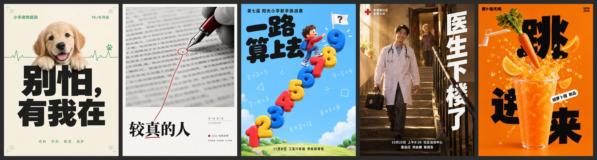
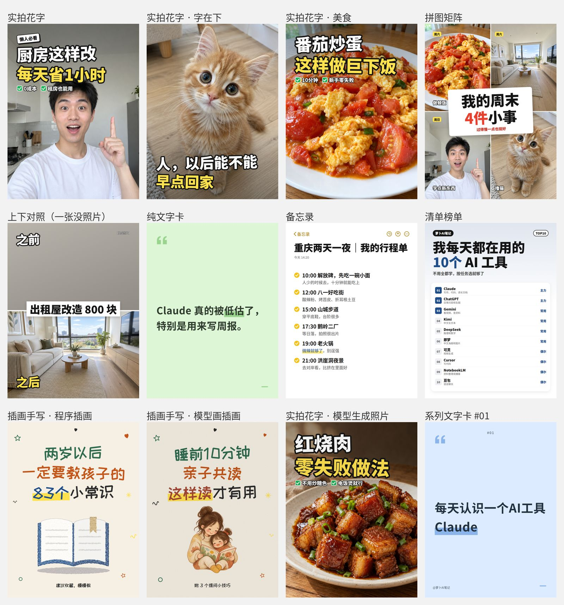
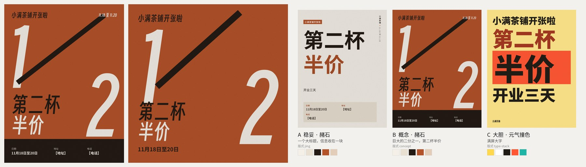
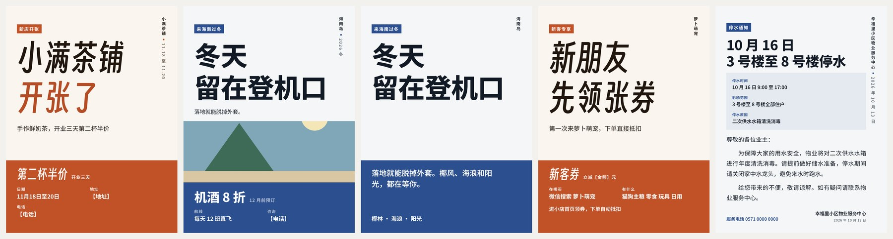
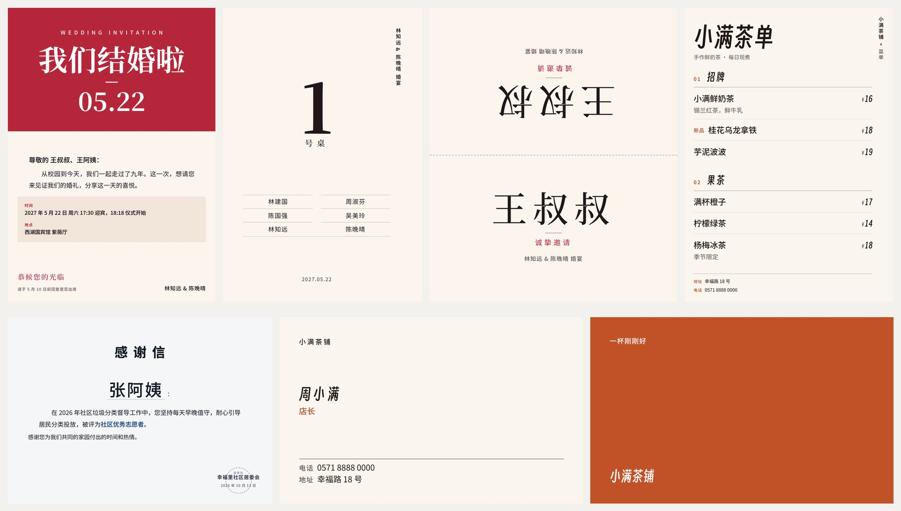
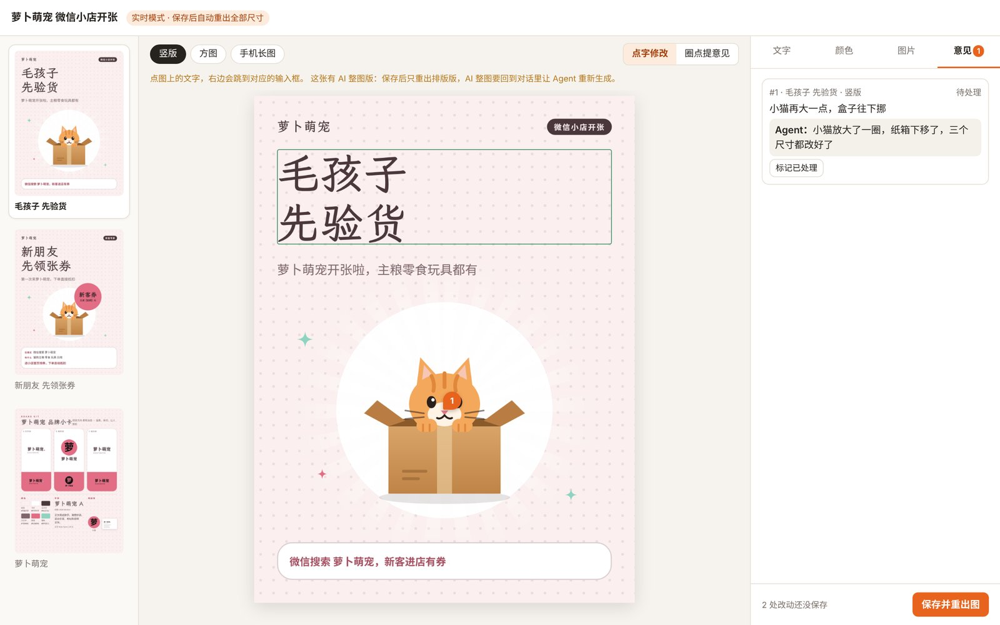
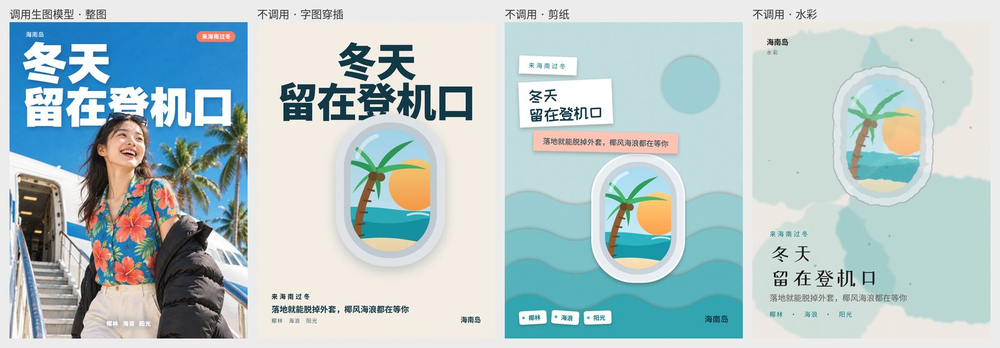

<p align="center"></p>

# luobo-design 萝卜设计

一句模糊的想法进去，能直接用的设计物料出来。给商家、老师、自媒体、社区和小团队用，开业海报、通知、菜单、请柬、奖状、名片、logo、小红书封面都能做。

它是一个遵循 SKILL.md 开放标准的 Agent skill，Claude、Codex、Gemini CLI、Cursor、GitHub Copilot 这类能执行命令、能看图片的 Agent 都能用。



## 它会做什么

接到需求，它按设计师接单的顺序走一遍：先把需求听懂，缺的信息最多问三个问题；海报会先想一个画面上的创意，比如律所招人想说“较真”，就画一支红钢笔在合同上圈出一个逗号；再出三个视觉方向让人看着选；然后写成一份规格文件，一条命令出图；最后自己检查文字溢出、对比度、广告法用语、还缺的信息，再把图拿出来看一遍。

能做的物料：

- 活动海报和正式通知，横、竖、方和 A4 印刷一次出齐
- 小红书封面，八种结构：实拍花字、文字卡、备忘录、清单榜单、拼图、前后对比、手绘插画、截图
- 价目表、菜单、课程表
- 邀请函和请柬（按宾客批量），能点的电子请柬 H5（导航、加入日历、倒计时、每位宾客一条专属链接）
- 奖状证书（整班批量）、桌号牌、席位卡、名片（带出血）
- logo 和品牌套件，文字转成矢量轮廓
- 先从内容里想概念，再由 Agent 亲手构图（概念版式），三个方向按稳妥、概念、大胆出
- 21 个视觉方向（其中素净组走克制路线），23 个节日包，10 种艺术画风（没接生图模型也能画）



## 先想概念，再亲手构图

海报不再从一组组固定风格里挑。Agent 先从这一单的内容里找一个想法：第二杯半价就画一个巨大的二分之一，小满茶铺就是一杯满而不溢的奶茶，每天省一小时就是五个工具拼成的表盘。想法定了，Agent 用概念版式亲手排这张图，脚本照样负责字体、排字、对比度、贴边和广告法检查，文案也照样能在编辑页里改。出三个方向给你选时，按稳妥、概念、大胆各出一个。



## 不土的默认风格

通知、菜单、请柬、证书这类信息优先的物料，和三个方向里的稳妥款，走素净组：有性格的中文标题字，店名和日期竖排在一边，信息收进一块平涂色块，只用一种强调色，没有照片时不硬塞插画。渐变铺底、毛玻璃、圆角卡片、emoji 这类一眼就像机器做的东西，检查时会提醒。





## 做完还能自己改

每次交付都带一个 `editor.html`，双击在浏览器里打开。点图上的字就能改，颜色、照片也能换，改完导出一份修改单发给 Agent。想提意见就切到“圈点提意见”，在图上点一下写下来，Agent 能看到你点在哪、那里原来写的是什么。



用 Claude Code、Codex、Cursor 这类本地 Agent 时，还能开实时编辑页（`python scripts/studio.py open spec.json`），在页面上点保存，全部尺寸几秒内就重出好了，不用回对话里说。

这一版还补了几样。同一份文案出方图、横版时，可以给这些尺寸单独写个短标题。截图会自动加圆角、阴影、浏览器框或手机框。没接生图模型时，能从 Pexels、Unsplash、Openverse 这些允许商用的免费图库找实拍照片，来源和署名要求都记下来。字压在照片上时，遮罩的颜色取自照片本身，只加到字刚好看得清，检查时还会把图缩成手机上的大小看一遍。品牌色是荧光色时会收成稳一点的同色，并说明改了什么。

再加三件小事。交付里有 `preview-feed.png` 和 `preview-moments.png`，把小红书封面放进信息流、海报放进朋友圈，按手机上的实际大小看。品牌做过一次就记住了，下次说“给萝卜萌宠做个双十一海报”，配色、字体、logo、电话地址自动沿用。模型看不了图时会自动换一套做法，靠程序检查，再请你看一眼。

## 接不接生图模型

不接也能用。字一律由排版程序排，画面用程序画的插画和画风滤镜，还会给出能贴进即梦、GPT Image、Nano Banana 的提示词。

想要照片级的画面，就接一个生图模型。接了以后，海报可以让模型按创意一步画出整张（连字一起），同时排一版备份；小红书封面可以生成不露脸的美食、家居照片和插画。真人出镜的封面建议用你自己的照片。



## 安装

电脑上有 Node.js 的话，一行装好（会自动认出你用的 Agent）：

```bash
npx skills add zhouwei713/luobo-design
```

也可以在 Agent 里说一句：

```text
帮我安装这个 skill：https://github.com/zhouwei713/luobo-design
```

或者手动装：

```bash
git clone https://github.com/zhouwei713/luobo-design.git ~/.claude/skills/luobo-design
pip install playwright pillow fonttools brotli
python -m playwright install chromium
```

其他 Agent 的装法见 [INSTALL.md](INSTALL.md)。

下载压缩包的话，最省事的办法是解压后运行 `install.sh`（macOS、Linux）或双击 `install.bat`（Windows），脚本会识别你装了哪些 Agent，复制过去，补装依赖，再跑一次自测。

## 怎么用

装好以后直接跟 Agent 说需求就行：

```text
小区门口开了家奶茶店，下周开业，帮我弄个海报
做个停水通知，周三上午九点到下午五点
帮我做个小红书封面，讲我每天在用的 10 个 AI 工具
婚礼请柬，5 月 22 日，宾客名单在 guests.txt
```

不支持 skill 的 Agent，可以让它先读一遍 `SKILL.md`，再按里面的步骤做。

想直接跑脚本也可以：

```bash
python scripts/pipeline.py examples/02-xiaohongshu-covers/spec.json
python scripts/studio.py open examples/02-xiaohongshu-covers/spec.json   # 打开实时编辑页
```

`examples/` 里有六份样例规格，宠物店开业、小红书封面、海南旅游、婚礼一套、电子请柬、社区通知，改改文字就能出你自己的。

## 生图模型配置

在工作目录放一份 `luobo-design.config.json`，或者放到 `~/.config/luobo-design/config.json`。key 不要写进文件，放环境变量。

```json
{
  "provider": "hiapi",
  "model": "gpt-image-2.5-flare/text-to-image",
  "api_key_env": "HIAPI_API_KEY",
  "resolution": "2K",
  "timeout": 240,
  "retries": 1
}
```

OpenAI、Gemini、即梦、兼容 OpenAI 接口的服务和本地命令也都支持，模板在 `templates/`，说明在 `references/imagegen.md`。

## 目录

| 路径 | 作用 |
|---|---|
| `SKILL.md` | 给 Agent 看的主说明，流程和硬规则 |
| `references/` | 行业包、物料说明、设计精华、方向和平台数据 |
| `scripts/` | 渲染、检查、生图、提示词、编辑页，`pipeline.py` 一条命令跑完 |
| `templates/` | 生图配置模板 |
| `examples/` | 六份样例规格 |
| `install.*` | 一键安装 |

## 许可

MIT
